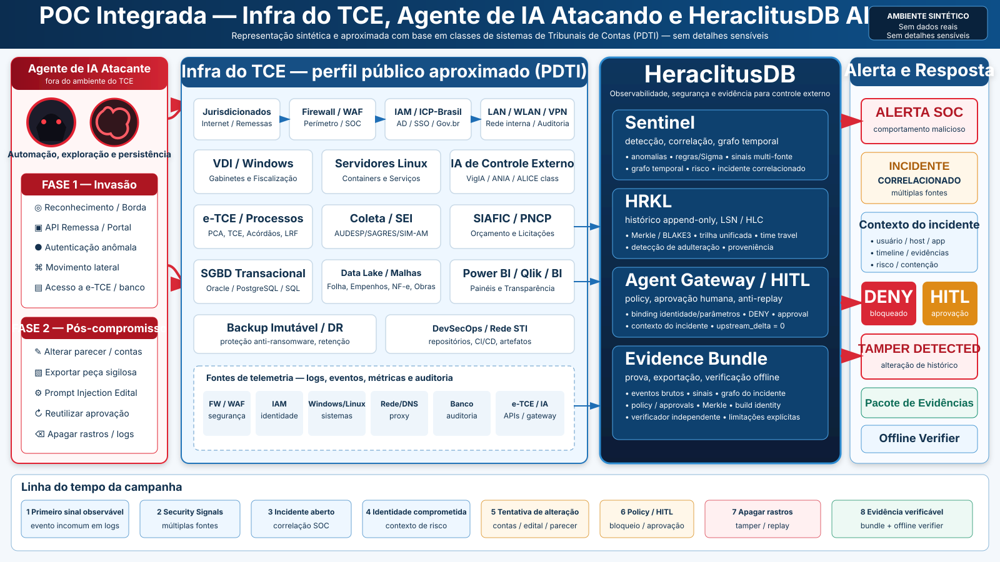
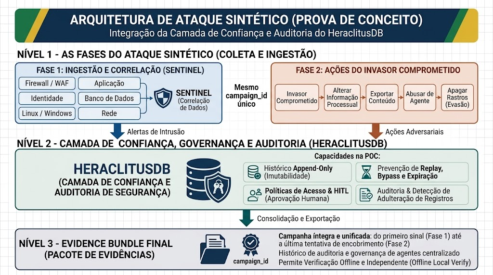
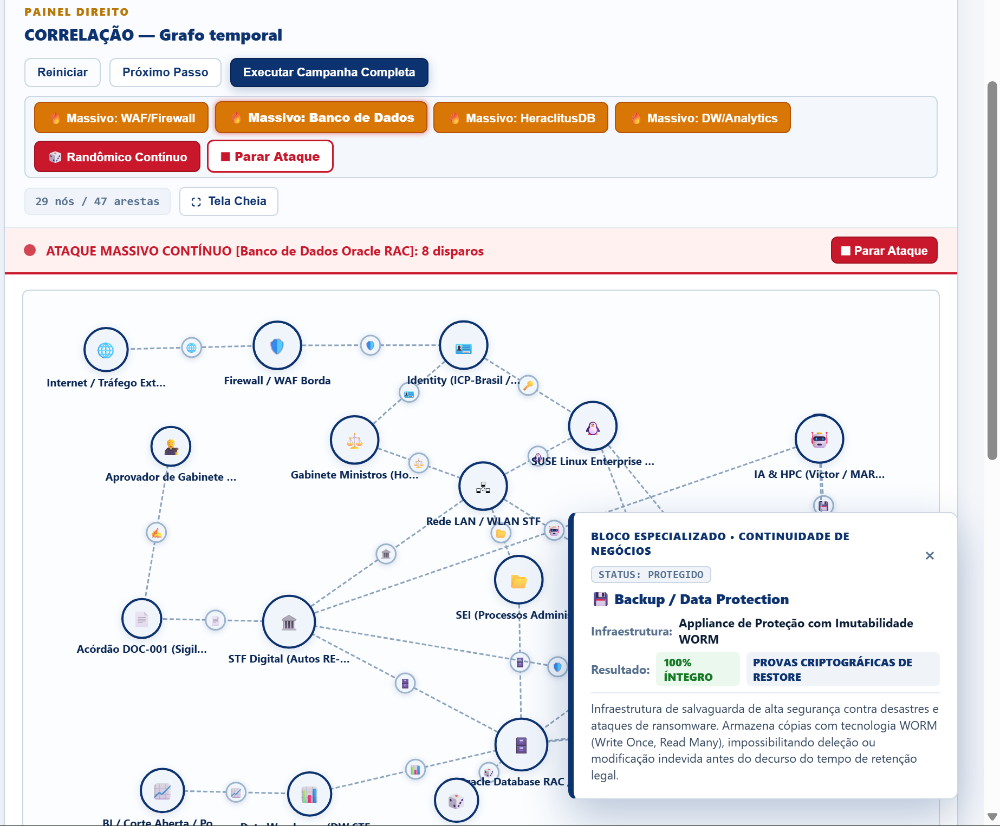
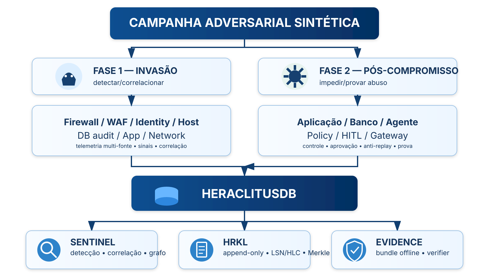

<p align="center">
  
</p>
<p align="center">
  
</p>
<p align="center">
  
</p>

# TCE — POC HeraclitusDB

> **Prova de conceito independente e integralmente sintética.** Este repositório não é produto oficial, homologado, certificado ou endossado por nenhum Tribunal de Contas do Estado (TCE), pelo TCU ou pela Atricon. Nenhum teste deve atingir infraestrutura real de qualquer Tribunal. A aproximação arquitetural usa apenas informações públicas e oficiais (Planos Diretores de TI — PDTI, atas no PNCP, relatórios públicos de segurança cibernética e diretrizes do MMD-TC).

---

## Histórico Público: Tribunais de Contas já foram invadidos?

Sim. Levantamentos oficiais do próprio ecossistema de Controle Externo brasileiro demonstram que as Cortes de Contas são alvos recorrentes de campanhas de *ransomware* e intrusão:

1. **Frequência Nacional (1 ataque a cada 41 dias):** levantamento divulgado no âmbito dos Tribunais de Contas registrou **pelo menos 13 ataques cibernéticos relevantes** contra TCs brasileiros em um intervalo de 18 meses (novembro de 2020 a abril de 2022) — média de **um incidente a cada 41 dias**.
2. **TCE-PR (Maio de 2022 — Ransomware):** ataque criptografou dados em servidores e estações de trabalho, com pedido de resgate em *bitcoins* (não pago graças à existência de backups íntegros) e suspensão de prazos processuais e sessões plenárias durante a reconstrução do ambiente.
3. **TCE-RS (Setembro de 2022 — Incidente Cibernético):** ataque hacker forçou a desabilitação preventiva do portal e dos sistemas processuais/corporativos, com suspensão de prazos e sessões.
4. **Diagnósticos do TCU:** auditorias de segurança cibernética apontam que mais de **80% dos ataques de *ransomware*** na Administração Pública exploram falhas de configuração, exposição de serviços de borda e comprometimento de contas privilegiadas ou de serviço.

Consulte o levantamento completo de incidentes, SOC, SGBDs (Oracle, PostgreSQL, SQL Server), sistemas (`e-TCE`, `AUDESP`, `SAGRES`, `SIM-AM`, `e-Sfinge`, `SIAFIC`, `PNCP`) e IA (`VigIA`, `ALICE`, `ANIA`) em **[TCE-PUBLIC-INFRA-BASELINE.md](docs/TCE-PUBLIC-INFRA-BASELINE.md)**.

---

# POC única, duas fases

A POC demonstra uma única campanha de ataque sintética do primeiro sinal observável na borda até a tentativa de alteração de processo de contas/parecer de auditoria, abuso de agente de IA e tentativa de adulteração e apagamento de rastros.

<p align="center">
  
</p>

> **Estado de implementação:** consulte [IMPLEMENTATION-STATUS.md](docs/IMPLEMENTATION-STATUS.md) para distinguir o que é calculado pelo código da POC, o que permanece sintético e o que depende de integração com o HeraclitusDB real.

> **Baseline técnico do HeraclitusDB:** veja [HERACLITUS-BASELINE.md](docs/HERACLITUS-BASELINE.md) (commit `8d3d78d0ef7c59ff1fdae04cc0864b94ddf7636c` — v3.0.1).

> **Guia Visual e Lâminas Arquiteturais:** veja [GUIA-VISUAL.md](docs/GUIA-VISUAL.md) para os diagramas da arquitetura integrada, fluxo de governança e visão executiva para Conselheiros, Auditores e Gestores.

## POC executável e dashboard

A implementação funcional está em [`poc/`](poc/README.md). Ela usa somente a biblioteca padrão do Python e foi desenhada para rodar **apenas em loopback**, sem scanner, exploit real, credencial institucional ou conexão com infraestrutura de nenhum TCE.

```bash
cd poc
python server.py
# No Windows (com launcher py):
py server.py
```

Abra no navegador:

```text
http://127.0.0.1:8787
```

Para executar a suíte completa de qualificação (119 testes unitários + smoke test HTTP em loopback):

```bat
run_tests.bat
```

No dashboard é possível executar a campanha **passo a passo** ou inteira e acompanhar:

- os sinais vindos de firewall/WAF (borda/remessa de jurisdicionados), IAM, host, rede, banco transacional e aplicação (`e-TCE`);
- o risco acumulado e a abertura do incidente no SOC;
- a identidade fictícia (`service-account-17`) associada ao comprometimento;
- o grafo temporal de atores, ativos, eventos e incidente;
- a tentativa de alteração do processo sintético de controle externo e o `DENY`;
- o contador independente de efeitos reais (`upstream_hits` / `upstream_delta=0`);
- o *Human-in-the-Loop* (HITL) e o consumo único da aprovação;
- replay, troca de identidade e alteração de parâmetros bloqueados;
- LSN, hash-chain e raiz Merkle;
- tentativa de adulteração (`modify`, `delete`, `reorder`, `truncate`);
- `Evidence Bundle` e verificação offline independente;
- Laboratório Forense de *Prompt Injection* em Editais/Peças Processuais e defesa em duas barreiras (consulte [ZANIN-PROMPT-INJECTION-LAB.md](docs/ZANIN-PROMPT-INJECTION-LAB.md));
- scorecard final da qualificação.

O servidor também possui adapter read-only preparado para superfícies reais do HeraclitusDB em **loopback** (`/sentinel/status`, `/api/v1/agent/status`, `/api/v1/agent/red-team/events` e núcleo gRPC `/heraclitus.v1.Heraclitus/Append` e `Query`). O modo standalone permanece 100% funcional quando um HeraclitusDB real não está ativo.

## Pergunta central

> **Se um atacante assistido por IA comprometer uma infraestrutura simulada semelhante, em classes de sistemas, ao ambiente publicamente documentado nos PDTIs dos Tribunais de Contas (TCE), o HeraclitusDB consegue correlacionar a intrusão desde o primeiro sinal observável, acompanhar sua progressão até o banco e o sistema processual (`e-TCE`), impedir alterações críticas em pareceres/contas sob enforcement (`upstream_delta = 0`), proteger agentes de IA contra *Prompt Injection* em editais e preservar uma linha do tempo verificável offline mesmo diante de tentativa de adulteração?**

## Fase 1 — Invasão (SOC / Sentinel)

A Fase 1 não executa exploração contra sistemas reais. Um **Attack Simulator** controlado produz telemetria realista de uma campanha autorizada em cyber range isolado.

Fontes sintéticas:

- firewall/WAF (portal institucional e gateway de remessa de jurisdicionados);
- autenticação/IAM (AD / SSO / ICP-Brasil sintético);
- servidores e estações Windows/Linux;
- rede/DNS/proxy;
- EDR/host telemetry;
- database audit (engine-neutral: Oracle / PostgreSQL / SQL Server class);
- application audit (`e-TCE` / Coleta `AUDESP`/`SAGRES`/`SIM-AM`/`e-Sfinge`);
- API/gateway (`SIAFIC` / `PNCP`);
- threat intelligence sintética.

Objetivo:

```text
sinal de borda (API remessa / portal)
   -> autenticação anômala (service-account-17)
   -> atividade anômala em host Linux
   -> movimento lateral para servidor de banco
   -> consulta fora do baseline no SGBD
   -> acesso a processo restrito no e-TCE
   -> INCIDENTE CORRELACIONADO
```

## Fase 2 — Atacante já dentro (Pós-Compromisso em Controle Externo e IA)

O mesmo `campaign_id` continua. O atacante sintético tenta:

- acessar informação restrita de fiscalização/denúncia;
- modificar metadados, saldos ou parecer de processo de contas fictício;
- executar operação privilegiada sem aprovação;
- exportar peça sigilosa;
- induzir agente de IA de auditoria de editais via *Indirect Prompt Injection*;
- reutilizar aprovação humana já consumida (*replay*);
- alterar parâmetros ou alvo depois da aprovação (*TOCTOU / parameter swap*);
- apagar, truncar, reordenar ou adulterar evidência no histórico.

O HeraclitusDB demonstra:

- **Policy enforcement (aplicação automática de políticas):** identidade ligada a incidente aberto de alto risco no SOC recebe `DENY` automático ao tentar alterar dados de processo (`OPEN_HIGH_RISK_INCIDENT`).
- **Human-in-the-Loop — HITL (aprovação humana):** operações de alto risco exigem aprovação humana explícita e de uso único antes da execução.
- **Anti-replay:** aprovação consumida não pode ser reutilizada (`REPLAY_DETECTED`).
- **Identity/parameter binding:** aprovação vale estritamente para quem pediu, qual ação pediu e com qual digest de parâmetros (`IDENTITY_BINDING_MISMATCH`, `ACTION_BINDING_MISMATCH`, `PARAMETERS_DIGEST_MISMATCH`).
- **`upstream_delta=0` quando uma ação é negada:** oráculo independente comprova que nenhuma execução chegou ao banco ou sistema protegido.
- **Detecção de adulteração:** qualquer tentativa de `modify`, `delete`, `reorder` ou `truncate` sobre o histórico é detectada por quebra de hash-chain, Merkle root e manifesto.
- **Reconstrução histórica (*Time Travel AS-OF LSN*):** reconstrução determinística do estado do processo em qualquer ponto do passado.
- **Evidence Bundle verificável offline:** pacote exportado e verificado por ferramenta independente (`poc/verify.py`) sem rede e com o servidor desligado.

## Perfil público aproximado de um TCE

A POC modela apenas **classes publicamente documentadas nos PDTIs dos Tribunais de Contas**, sem reproduzir topologia sensível:

- `e-TCE` / sistemas de processo eletrônico de controle externo (PCA, TCE, Atos de Pessoal, LRF, Acórdãos);
- sistemas de coleta e remessa eletrônica de jurisdicionados (`AUDESP`, `SAGRES`, `SIM-AM`, `e-Sfinge`, `CidadES`, `SICOM`, `SIGA`, `Geo-Obras`);
- integrações `SIAFIC` (Decreto nº 10.540/2020), `PNCP` (Lei nº 14.133/2021) e `SEI`;
- SGBDs transacionais (**Oracle**, **PostgreSQL**, **SQL Server**);
- Data Warehouse / Data Lake para malhas eletrônicas de fiscalização e BI (**Power BI**, **Qlik**, **Superset**);
- infraestrutura Linux/Windows, VDI, LAN/WLAN/VPN e Backup Imutável anti-ransomware;
- assistentes de IA de controle externo (**VigIA**, **ALICE**, **ANIA**, **ChatTCU**, **SEI-IA**, **Ana JúlIA**).

Veja [TCE-PUBLIC-INFRA-BASELINE.md](docs/TCE-PUBLIC-INFRA-BASELINE.md) e [SPEC-0027](specs/SPEC-0027-tce-public-environment-profile.md).

## Resultado final da POC

```text
PHASE1_TELEMETRY_INGEST          PASS
PHASE1_RULE_DETECTION            PASS
PHASE1_CROSS_SOURCE_CORRELATION  PASS
PHASE1_INCIDENT_GRAPH            PASS
PHASE1_PROVENANCE                PASS

PHASE2_UNAPPROVED_WRITE          DENY
PHASE2_HITL_WRITE                PASS
PHASE2_REPLAY                    DENY
PHASE2_IDENTITY_SWAP             DENY
PHASE2_PARAMETER_SWAP            DENY
PHASE2_UPSTREAM_ON_DENY          0

HISTORY_TAMPER                   DETECTED
LOG_DELETE                       DETECTED
EVENT_REORDER                    DETECTED
TIME_TRAVEL                      PASS
EVIDENCE_EXPORT                  PASS
OFFLINE_VERIFY                   PASS

REAL_TCE_DATA                    NOT_USED
REAL_TCE_NETWORK                 NOT_USED
INSTITUTIONAL_IAM                NOT_CONFIGURED
INSTITUTIONAL_HSM                NOT_CONFIGURED
EXTERNAL_TRUST                   UNVERIFIED
```

## SPECs

### Base transversal

- [SPEC-0001](specs/SPEC-0001-scope-success-criteria.md) — escopo e critérios de sucesso
- [SPEC-0002](specs/SPEC-0002-reference-architecture.md) — arquitetura end-to-end
- [SPEC-0003](specs/SPEC-0003-synthetic-event-model.md) — evento canônico e campaign identity
- [SPEC-0004](specs/SPEC-0004-integrity-tamper-detection.md) — integridade, Merkle e tamper detection
- [SPEC-0005](specs/SPEC-0005-agent-governance-hitl.md) — Agent Gateway e HITL
- [SPEC-0006](specs/SPEC-0006-adversarial-security-tests.md) — campanha adversarial
- [SPEC-0007](specs/SPEC-0007-evidence-bundle-offline-verifier.md) — Evidence Bundle e verificador offline
- [SPEC-0008](specs/SPEC-0008-temporal-reconstruction.md) — reconstrução temporal (`AS OF LSN`)
- [SPEC-0009](specs/SPEC-0009-reproducible-airgap-deployment.md) — implantação isolada e air-gap friendly
- [SPEC-0010](specs/SPEC-0010-demo-runbook.md) — runbook integrado da demonstração
- [SPEC-0011](specs/SPEC-0011-observability-performance.md) — observabilidade e desempenho
- [SPEC-0012](specs/SPEC-0012-governance-privacy-pilot-transition.md) — governança, privacidade e transição para piloto
- [SPEC-0013](specs/SPEC-0013-threat-model-security-assumptions.md) — threat model integrado
- [SPEC-0014](specs/SPEC-0014-cryptographic-trust-time.md)..[SPEC-0020](specs/SPEC-0020-risk-register-pilot-readiness.md) — confiança criptográfica, supply chain, CI/mutation gates, fault injection, APIs, UX e matriz de riscos

### Fase 1 / Ponte para Fase 2 / Controle Externo TCE

- [SPEC-0021](specs/SPEC-0021-security-telemetry-ingestion.md) — ingestão de telemetria
- [SPEC-0022](specs/SPEC-0022-intrusion-detection-correlation.md) — detecção e correlação multi-fonte
- [SPEC-0023](specs/SPEC-0023-attack-graph-incident-lifecycle.md) — grafo da campanha e ciclo de vida do incidente
- [SPEC-0024](specs/SPEC-0024-soc-response-containment.md) — alerta SOC, resposta e containment sintético
- [SPEC-0025](specs/SPEC-0025-post-compromise-process-abuse.md) — abuso pós-compromisso em processo de contas (`e-TCE`)
- [SPEC-0026](specs/SPEC-0026-two-phase-end-to-end-qualification.md) — qualificação ponta a ponta em duas fases
- [SPEC-0027](specs/SPEC-0027-tce-public-environment-profile.md) — perfil público aproximado dos Tribunais de Contas (TCE)
- [SPEC-0028](specs/SPEC-0028-document-injection-firewall-editais.md) — Document & LLM Injection Firewall para Editais e Prestações de Contas

## Regra de ouro

```text
CLAIM
 -> SOURCE/ASSUMPTION
 -> SPEC
 -> TEST
 -> EXPECTED
 -> OBSERVED
 -> EVIDENCE
 -> LIMITATION
```

A POC é forte quando um ataque ou sabotagem muda corretamente o resultado para `DENY`, `DETECTED`, `FAIL` ou `UNKNOWN`. Um dashboard eternamente verde é só um protetor de tela com autoestima.
