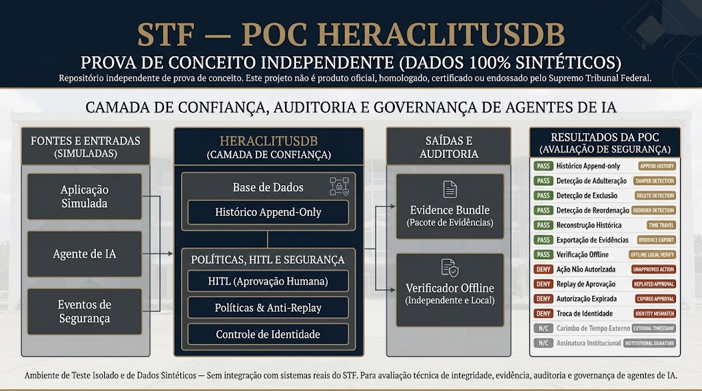
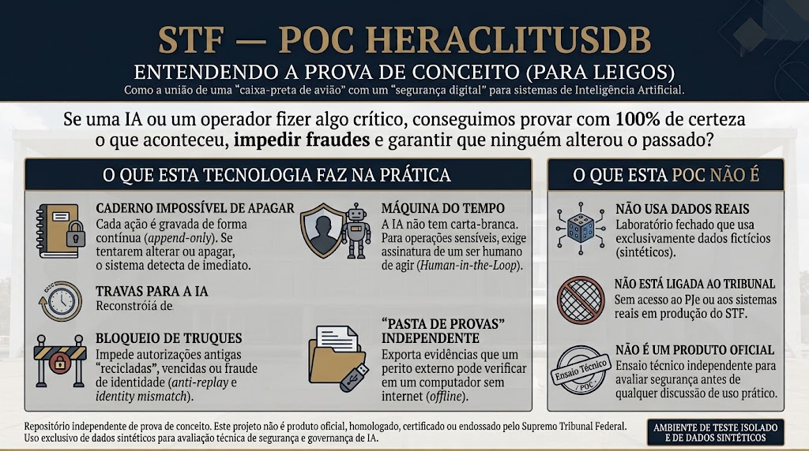
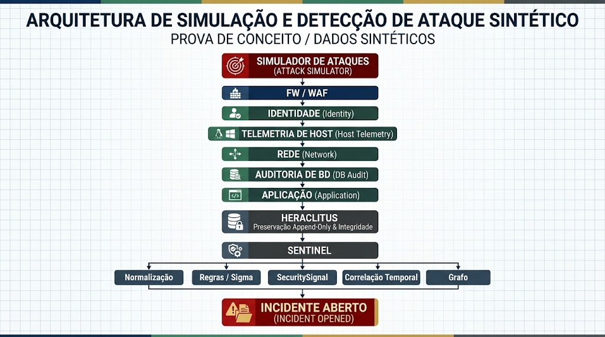
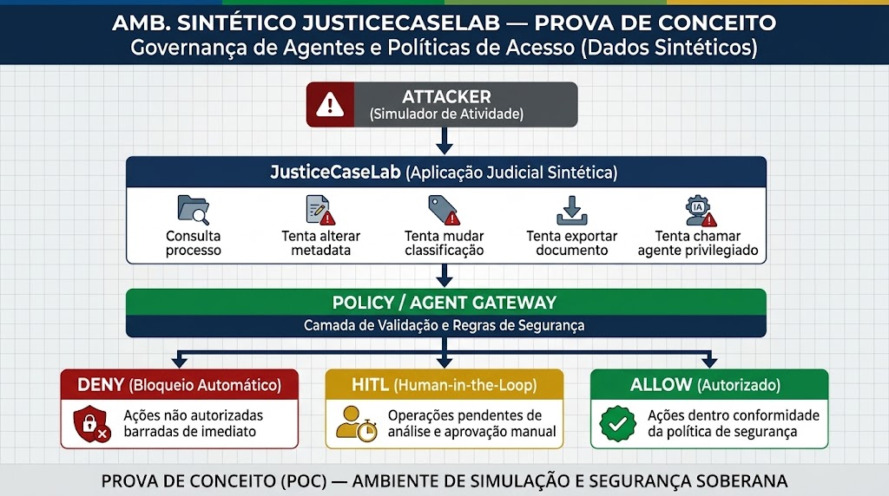

# Guia Visual da Arquitetura — POC TCE / HeraclitusDB

Este documento reúne os diagramas e infográficos arquiteturais que ilustram o funcionamento, os controles de segurança e os fluxos da Prova de Conceito para Tribunais de Contas (TCE).

---

## 1. Visão Geral da Arquitetura Integrada (TCE + HeraclitusDB)
> Representação sintética e aproximada com base em classes de sistemas publicamente documentadas nos PDTIs dos Tribunais de Contas (e-TCE, Coleta AUDESP/SAGRES/SIM-AM/e-Sfinge, SIAFIC/PNCP, SGBDs Oracle/PostgreSQL/SQL Server, Data Lake, IA de Auditoria e SOC), simulando a campanha adversarial, a ingestão multi-fonte pelo Sentinel, a preservação append-only no HRKL, as políticas do Agent Gateway e a geração do Evidence Bundle.

  

---

## 2. Campanha Adversarial Sintética em Duas Fases
> O mesmo `campaign_id` une a Fase 1 (Detecção e Correlação multi-fonte no Sentinel) e a Fase 2 (Ações do atacante pós-comprometimento sobre processos de contas/licitações e tentativa de evasão), culminando no Evidence Bundle verificável offline.

  

---

## 3. Camada de Confiança, Auditoria e Governança de Agentes de IA
> Visão em blocos funcionais: Fontes simuladas → HeraclitusDB (Camada de Confiança) → Saídas e Auditoria → Resultados da Qualificação técnica da POC.

  

---

## 4. Entendendo a Prova de Conceito (Visão Executiva / Para Conselheiros, Auditores e Gestores)
> Como a união de uma "caixa-preta de avião" (HRKL append-only + Merkle) com um "segurança digital" (Sentinel + Agent Policy Gateway) protege processos de contas, malhas de fiscalização e sistemas de Inteligência Artificial contra ações não autorizadas, ransomware/tampering e adulterações retroativas.

  

---

## 5. Simulação e Detecção de Intrusão em Pipeline
> Do gerador de telemetria até a normalização, regras determinísticas, emissão de `SecuritySignal`, correlação temporal em grafo e abertura do incidente para bloqueio contextual na Fase 2.

  

---

## 6. Governança de Agentes e Políticas de Acesso em Processos de Controle Externo
> Ações sensíveis em processos fictícios (consulta, alteração de metadados/parecer, mudança de classificação de sigilo, exportação de peça restrita e chamada de ferramenta de IA) filtradas por `DENY`, `HITL` ou `ALLOW` com verificação de `upstream_delta = 0`.

  

