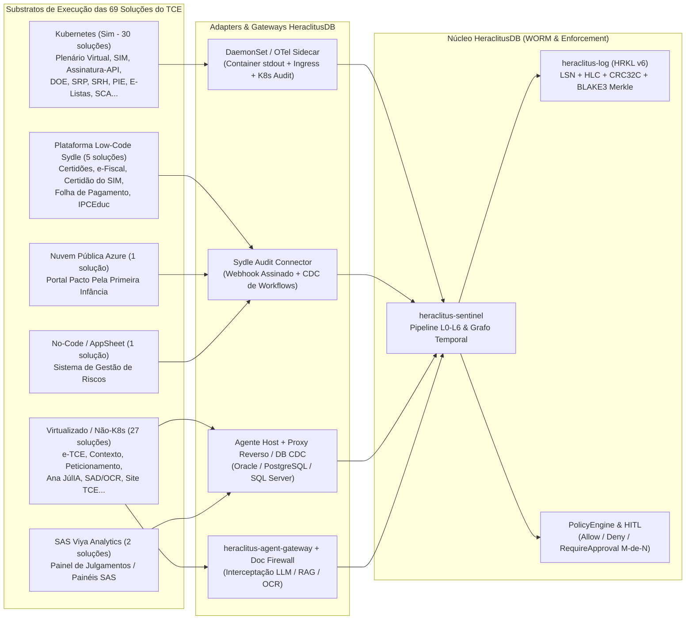

# SPEC-0029 — Catálogo Completo de Sistemas (Matriz TCE-CE), Recalibração de Criticidade Cibernética e Contratos de Log no HeraclitusDB

**Status:** Proposed  
**Classe:** System Inventory, Log Ingestion & Enforcement Matrix (TCE Ceará / Referência Estadual)  
**Prioridade:** P0  
**Dependências:** SPEC-0003, SPEC-0004, SPEC-0005, SPEC-0021, SPEC-0025, SPEC-0027, SPEC-0028

---

## 1. Objetivo

Especificar, para **todas as 69 soluções de TI** mapeadas na matriz de **Reavaliação dos Níveis de Criticidade das Soluções de TI (TCE-CE)** (19 Críticas, 20 Médias, 24 Baixas e 6 em processo de exclusão/unificação):

1. **Quais eventos e logs cada sistema gera** e como são ingeridos pelo **HeraclitusDB** (`heraclitus-log` HRKL v6, `heraclitus-sentinel` L0–L6, `heraclitus-agent-gateway` e `heraclitus-compliance`);
2. **Atenção prioritária às 19 Soluções Críticas**, detalhando o vetor de ameaça, os eventos obrigatórios (`SecurityEvent` / recibo WORM), o mecanismo de coleta conforme a infraestrutura hospedeira (**Kubernetes**, **Sydle Low-Code**, **VM/Não-K8s**, **Azure**, **AppSheet**, **SAS Viya**) e as políticas de bloqueio ativo (`DENY` / `RequireApproval` HITL);
3. **Recalibração de Criticidade Cibernética vs. Criticidade de Negócio**, elevando para **P0 de Segurança** sistemas que na planilha administrativa figuram como "Média", "Baixa" ou "Exclusão", mas que são vitais contra invasão, fraude processual ou exfiltração (ex.: **SCA - Controle de Acesso**, **SISAUT**, **Recuperação de Senha**, **E-Listas**, **PIE**, **Ana JúlIA**, **SAD/OCR** e **Painel da Prescrição**).

---

## 2. Arquitetura de Coleta por Plataforma de Execução (`Esta no K8 ?`)

A matriz de sistemas do TCE-CE distribui as aplicações em seis substratos tecnológicos distintos. O HeraclitusDB ingere telemetria e impõe governança respeitando a natureza de cada substrato:



| Valor na Coluna `Esta no K8 ?` | Estratégia de Coleta e Interceptação para o HeraclitusDB |
|---|---|
| **`Sim` (Kubernetes)** | **DaemonSet + Ingress/Service Mesh Tap + K8s Audit Webhook:** captura logs estruturados JSON de todos os pods, chamadas entre microsserviços (especialmente para `Assinatura - API`, `SCA`, `SIM` e `Plenário Virtual`) e eventos do `kube-apiserver` (exec em pod, leitura de `Secret`, alteração de `Deployment`). |
| **`Sydle` (Plataforma Low-Code)** | **Sydle Audit Webhook + API Gateway Interceptor:** como múltiplos sistemas críticos (`Certidões`, `e-Fiscal`, `Certidão do SIM`, `Folha de Pagamento`) compartilham o motor low-code Sydle, um comprometimento de conta administrativa ou de conector no Sydle afeta várias soluções críticas simultaneamente. O HeraclitusDB exige gravação imutável de: (a) emissão/validação de cada certidão; (b) alterações de definição de classe/workflow low-code; (c) consultas e alterações na `Folha de Pagamento`. |
| **`Nao` / Em Branco (VMs / Bare-Metal)** | **Transactional Outbox + DB Audit Trigger + Reverse Proxy Tap:** para sistemas monolíticos/virtualizados como o **`e-TCE`**, **`Contexto`**, **`Peticionamento`** e **`Ana JúlIA`**, o HeraclitusDB intercepta as transações na camada de aplicação/gateway e reconcilia diretamente com o CDC/Audit do SGBD (Oracle/PostgreSQL/SQL Server), detectando qualquer *bypass* direto no banco (`SPEC-0025`). |
| **`Sim/Nao` (Híbrido — ex.: `Ágora`)** | **Coleta Dual (K8s DaemonSet + DB Outbox Legado):** correlaciona pelo mesmo `correlation_id` os microsserviços em K8s (recepção de peças) e o backend legado de processamento de contas estaduais. |
| **`Azure` (Nuvem Pública)** | **Azure Event Hub / Activity Log Forwarder:** exportação contínua de logs de acesso, mudanças de conteúdo e integridade de dados públicos para o HeraclitusDB on-premises. |
| **`AppSheet` / `SAS Viya`** | **Audit Log Exporter:** coleta de trilhas de leitura/exportação em massa (CSV/Excel) e alterações na Matriz de Riscos institucional. |

---

## 3. Foco Principal: As 19 Soluções de Criticidade **CRÍTICA** (Prioridade P0)

Todas as **19 soluções Críticas** possuem **retenção WORM em `heraclitus-log` (HRKL v6)**, **monitoramento em tempo real no `heraclitus-sentinel` (L0–L6)** e **regras de contenção determinística (`DENY` / `HITL`)**.

### 3.1 Tabela de Engenharia de Logs e Proteção das 19 Soluções Críticas

| # | Solução | K8s? | Eventos Críticos Auditados no HeraclitusDB (`EventKind`) | Vetor de Ameaça / Fraude que o HeraclitusDB Impede ou Detecta | Modo HeraclitusDB |
|---|---|---|---|---|---|
| **01** | **Plenário Virtual** | `Sim` | Abertura/encerramento de sessão de julgamento; registro de voto de Conselheiro/Substituto; pedido de vista; sustentação oral; proclamação de resultado e hash da pauta/acórdão (184 municípios + Estado). | **Adulteração de Voto ou Resultado de Julgamento:** tentativa de alterar voto proferido ou resultado proclamado após o fechamento da sessão virtual, ou uso de sessão sequestrada durante incidente aberto no SOC. | **Enforcement (`DENY` / HITL)** + Prova Merkle por Sessão |
| **02** | **e-TCE** *(Sistema de Processo Eletrônico)* | `Nao` | Autuação; juntada/exclusão de peça; despacho; instrução técnica; parecer do MPC; mudança de fase/status; acesso a autos sigilosos; baixa/arquivamento; vínculo com `Assinatura - API`. | **Abuso Pós-Compromisso (`Fraud-2` / `SPEC-0025`):** alteração silenciosa de parecer técnico/acórdão (ex.: de *Irregular com Débito* para *Regular com Ressalva*), supressão de peça probatória ou adulteração direta via SGBD por DBA comprometido. | **Enforcement (`DENY` + HITL Uso Único + Reconciliação DB)** |
| **03** | **Portal de Serviços** *(78 serviços)* | `Sim` | Autenticação do cidadão/jurisdicionado; invocação de qualquer um dos 78 serviços; taxa de requisições por IP/CPF/CNPJ; falhas de autorização; redirecionamento para sistemas internos. | **Abuso de Borda, Credential Stuffing e Pivotamento:** uso do hub único de 78 serviços como ponto de entrada para explorar APIs internas (`Certidões`, `Peticionamento`, `SAOP`, `e-Fiscal`). | **Sentinel L0–L3 (WAF/API Telemetry + Rate/Taint)** |
| **04** | **Certidões** *(Gestão de Certidões)* | `Sydle` | Solicitação, consulta às bases internas (contas irregulares, processos), emissão, código de validação, hash SHA-256/BLAKE3 do PDF emitido e qualquer edição de regra/fluxo no Sydle. | **Emissão Fraudulenta de Certidão Negativa (`Fraud-3`):** emissão de *Certidão Negativa de Contas Julgadas Irregulares* (PF ou Nomeação em Cargo Público) para gestor ficha-suja/inabilitado mediante manipulação de regra low-code ou *bypass* de consulta ao `e-TCE`. | **Enforcement (`DENY` sem lastro íntegro no `e-TCE`) + Selo Merkle de Certidão** |
| **05** | **e-Fiscal** *(RREO, RGF e Certidões Fiscais)* | `Sydle` | Submissão de RREO/RGF; cálculo de limites da LRF (despesa com pessoal, endividamento); disparo/supressão de alertas automáticos; emissão de certidão fiscal; alteração de parâmetros fiscais. | **Maquiagem Fiscal e Supressão de Alerta LRF:** alteração de indicadores do RREO/RGF ou desativação de alerta automático de descumprimento de limite prudencial/máximo da LRF para favorecer ente jurisdicionado. | **Enforcement (`DENY` em edição manual de cálculo LRF) + Trilha WORM** |
| **06** | **Certidão do SIM** *(Art. 42 CE)* | `Sydle` | Verificação de entrega de todas as remessas mensais obrigatórias no `SIM`; emissão/revogação da Certidão de Adimplência do SIM; exceções ou prorrogações manuais de inadimplência. | **Liberação Indevida de Município Inadimplente:** concessão fraudulenta de Certidão de Adimplência do SIM (exigida pelo Art. 42 da Constituição Estadual para recebimento de transferências/convênios) para prefeitura que não enviou as contas mensais. | **Enforcement (`DENY` se o hash do recibo `SIM` não existir no log)** |
| **07** | **e-Transparência** *(Certidões de Transparência)* | `Sim` | Avaliação de regularidade de transparência fiscal de Prefeituras e Câmaras; emissão eletrônica da certidão; alteração de checklist/nota de transparência municipal. | **Manipulação de Índice/Certidão de Transparência:** alteração não autorizada do status de regularidade de transparência ativa/passiva de Prefeitura ou Câmara Municipal. | **Enforcement + Recibo Assinado no `heraclitus-log`** |
| **08** | **Folha de Pagamento** *(Membros e Servidores)* | `Sydle` | Geração de prévia e fechamento de folha; inclusão/alteração de rubricas, vantagens, retroativos ou dados bancários; emissão de comprovante de rendimentos; leitura em lote de contracheques. | **Fraude Financeira Interna e Exfiltração de Dados Pessoais (LGPD):** inserção de rubrica/pagamento indevido, desvio de conta bancária ou raspagem em massa de rendimentos de Conselheiros, Procuradores e Servidores. | **Enforcement (HITL M-de-N para mudança de rubrica/banco) + Selo LGPD** |
| **09** | **SIM (`SIM`, `SIMWEB`, `PGI`, `API Dados Abertos`)** | `Sim` | Recepção de pacotes mensais dos 184 municípios (orçamento, execução, licitações, pessoal); validação estrutural; geração de recibo de entrega; publicação na `API Dados Abertos`. | **Substituição Retroativa de Remessa Municipal ou Injeção na Carga:** substituição silenciosa de arquivo mensal já protocolado para ocultar desvio contábil após abertura de auditoria, ou injeção de payload malicioso via pacote do município. | **Sentinel L0–L2 na Ingestão + Cadeia de Custódia Imutável por Remessa** |
| **10** | **Contexto** *(Motor de Busca Processual)* | `Nao` (VM) | Indexação de pareceres, acórdãos, despachos, ofícios e votos; consultas realizadas por usuários internos (termos buscados, documentos abertos, volume por sessão); sincronismo com `e-TCE`. | **Reconhecimento Pós-Invasão (*Internal Recon*) e Envenenamento de Índice:** atacante com credencial comprometida usa o `Contexto` para buscar processos sigilosos, denúncias ou palavras-chave sensíveis em toda a base documental da Corte; ou oculta acórdão do índice de busca. | **Sentinel L3 (Anomalia de Volume/Z-Score de Busca) + Auditoria de Acesso** |
| **11** | **Diário - (`DOE` / `DOE Consulta`)** | `Sim` | Fechamento de edição diária do DOE-TCE; assinatura digital do caderno; publicação de acórdãos, pautas, citações e portarias (histórico desde 17/11/2014). | **Adulteração Retroativa de Publicação Oficial (*Backdating*):** tentativa de substituir o conteúdo de um Diário Oficial já publicado para alterar data de intimação/citação (afetando prazos e prescrição) ou texto de acórdão. | **Raiz Merkle Diária Publicada + Verificação Offline (`SPEC-0007`)** |
| **12** | **Assinatura - API** *(Assinatura Digital)* | `Sim` | Toda requisição de assinatura eletrônica/ICP-Brasil vinda de aplicações internas (`e-TCE`, `Plenário Virtual`, `DOE`, `Certidões`, `SCIE`); certificado utilizado; hash do documento assinado; IP/workload de origem. | **Abuso de Serviço Criptográfico (*Signing Oracle Abuse*):** aplicação ou conta de serviço comprometida chama a `Assinatura - API` para assinar eletronicamente certidão, despacho ou minuta fraudulenta sem ação humana real do titular. | **Enforcement Crítico (Binding estrito Usuário + Sessão + Hash do Documento)** |
| **13** | **Ouvidoria** | `Sim` | Registro de manifestação (eletrônica, telefônica, presencial); classificação de sigilo/anonimato; encaminhamento para unidades técnicas; resposta institucional; exportação de dados de manifestantes. | **Quebra de Sigilo de Manifestante / Supressão de Demanda:** exposição da identidade de cidadão denunciante (violação da LGPD e Lei de Proteção ao Denunciante) ou apagamento de manifestação contra gestor público. | **Crypto-Shredding / Proteção PII (`heraclitus-compliance`) + Log WORM** |
| **14** | **Portal da Transparência (TCE-CE)** | `Sim` | Publicação e atualização de dados de execução orçamentária, financeira, contratos e diárias do próprio TCE-CE; logs de acesso e integridade do dataset publicado. | **Adulteração de Dados de Transparência Institucional ou Defacement:** modificação maliciosa de valores publicados ou indisponibilização deliberada do portal para gerar passivo reputacional e descumprimento da LAI. | **Reconciliação de Hash entre SGBD Financeiro e Portal Público** |
| **15** | **Portal do Cidadão** | `Nao` (Web) | Atualização de painéis sobre gastos dos municípios cearenses; consultas públicas; sincronização de dados consolidados a partir do `SIM` e do `e-TCE`. | **Desinformação Pública / Divergência de Dados Municipais:** manipulação dos indicadores exibidos ao cidadão sobre gastos de prefeituras (ex.: ocultar despesa ou inflar indicador em período pré-eleitoral). | **Proveniência Criptográfica (Dado exibido $\rightarrow$ LSN da remessa no `SIM`)** |
| **16** | **SRP - Sistema de Registro de Pessoal** | `Sim` | Recepção e análise de atos de nomeação, aposentadoria, reforma e pensão de servidores estaduais; parecer de legalidade/ilegalidade; registro tácito por decurso de prazo; integração `WS-Atos`. | **Aprovação Fraudulenta de Aposentadoria/Pensão Ilegal:** alteração de parecer de ato de pessoal ou retenção intencional do processo para forçar o **registro tácito** (decadência quinquenal) de benefício com valor irregular. | **Enforcement (`DENY` em mudança sem parecer assinado) + Alerta de Prazo** |
| **17** | **Peticionamento** | `Nao` (Web) | Abertura de protocolo no `e-TCE` por jurisdicionados e cidadãos; upload de documentos/anexos (PDF, XML, planilhas); geração de recibo de protocolo com carimbo de tempo; validação de procuração/credencial. | **Injeção de Malware / *Indirect Prompt Injection* (`SPEC-0028`) e Repúdio de Protocolo:** envio de PDF de defesa/edital contendo instruções ocultas para enganar a IA (`Ana JúlIA` / `Jurisprudência`), ou alegação falsa de que um recurso foi protocolado dentro do prazo. | **Document Injection Firewall (L0–L6) no Upload + Recibo HLC/LSN Imutável** |
| **18** | **SRH - Sistema de Recursos Humanos** | `Sim` | Cadastro e alteração de histórico funcional de Conselheiros, Auditores, Procuradores, Servidores e Estagiários; lotação; designação para funções de confiança/comissões; férias e licenças. | **Elevação Indevida de Privilégio Funcional ou Vazamento de Dados Funcionais:** alteração fraudulenta de lotação/função no SRH para induzir concessão automática de permissão no `SCA`/`e-TCE`, ou exfiltração de dados pessoais de autoridades. | **Correlação SRH $\leftrightarrow$ SCA no Sentinel + Selo LGPD** |
| **19** | **Site Institucional TCE** | `Nao` | Publicação de notícias, avisos de pauta, links para o `Portal de Serviços` e portais municipais; alterações de templates/scripts; tráfego de borda (WAF/CDN). | **Defacement, *Watering Hole* e Phishing Institucional:** injeção de script malicioso (*malvertising/skimmer*) ou troca de link do `Portal de Serviços` / `Peticionamento` para capturar credenciais e certificados de prefeitos, contadores e auditores. | **File/Content Integrity Monitoring no Log + Telemetria WAF (Fase 1)** |

---

### 3.2 Detalhamento Arquitetural dos 4 Agrupamentos Críticos do TCE-CE

#### A. Núcleo Decisório e Processual (`Plenário Virtual`, `e-TCE`, `Assinatura - API`, `Diário - DOE`, `Peticionamento`, `Contexto`)
- **Problema real:** O `e-TCE` e o `Contexto` **não estão no Kubernetes** (`Esta no K8 ?: Nao`), enquanto `Plenário Virtual`, `Assinatura - API` e `Diário - DOE` **estão no Kubernetes** (`Sim`). Um atacante que comprometa a rede interna ou uma conta de serviço tenta explorar a fronteira entre o ambiente virtualizado legado (`e-TCE` + SGBD) e os microsserviços em K8s (`Assinatura - API` / `Plenário Virtual`).
- **Como o HeraclitusDB atua:**
  1. **Recibo Criptográfico de Protocolo (`Peticionamento`):** cada petição gera um registro `HRKL v6` com `LSN`, `HLC` e hash `BLAKE3` de todos os anexos PDF antes de entrar no `e-TCE`.
  2. **Inspeção de Documentos (`SPEC-0028`):** todo PDF peticionado passa pelo **Document Injection Firewall** antes de ser indexado pelo `Contexto` ou lido por LLMs (`Ana JúlIA` / `Jurisprudência`).
  3. **Binding Transacional de Assinatura (`Assinatura - API` $\leftrightarrow$ `e-TCE` / `Plenário Virtual`):** a `Assinatura - API` só assina um ato se existir um token de intenção válido vinculado ao `actor_id`, à sessão MFA/ICP-Brasil ativa e ao digest exato da peça processual, bloqueando chamadas órfãs de contas de serviço comprometidas (`service-account-17`).
  4. **Fechamento de Julgamento e Publicação (`Plenário Virtual` $\rightarrow$ `DOE`):** a ata de julgamento do `Plenário Virtual` e a edição do `DOE` geram raízes Merkle verificáveis offline (`SPEC-0007`), tornando matematicamente impossível alterar um acórdão ou data de publicação retroativamente sem detecção imediata.

#### B. Ecossistema Crítico em Low-Code Sydle (`Certidões`, `e-Fiscal`, `Certidão do SIM`, `Folha de Pagamento`)
- **Problema real:** Quatro das 19 soluções **Críticas** do TCE-CE rodam sobre a plataforma **Sydle** (`Certidões`, `e-Fiscal`, `Certidão do SIM` e `Folha de Pagamento`). Em arquiteturas low-code corporativas, desenvolvedores cidadãos ou administradores da plataforma possuem alto poder para editar fluxos, regras de negócio, conectores e objetos de dados.
- **Como o HeraclitusDB atua:**
  1. **Trilha de Auditoria de Metadados Low-Code:** qualquer alteração em definição de workflow, regra de elegibilidade de certidão ou fórmula da LRF no Sydle é tratada como **operação administrativa crítica (`SPEC-0089`)**, exigindo aprovação **HITL (M-de-N)** no `heraclitus-agent-gateway`.
  2. **Prova de Lastro para Emissão de Certidões (`Certidões` e `Certidão do SIM`):** nenhuma Certidão Negativa ou Certidão de Adimplência do SIM é considerada válida sem o registro no `heraclitus-log` contendo os `LSNs` das consultas feitas ao `e-TCE` e ao `SIM` no instante da emissão (impedindo a emissão de certidão limpa mediante *mock* ou *bypass* do fluxo low-code).
  3. **Proteção da `Folha de Pagamento`:** alterações de dados bancários, criação de rubricas extraordinárias ou exportações completas da folha no Sydle disparam regras determinísticas no `heraclitus-sentinel` e exigem dupla aprovação humana vinculada aos parâmetros (`PARAMETERS_DIGEST_MISMATCH` se houver tentativa de troca pós-aprovação).

#### C. Malha de Contas Municipais e Transparência (`SIM`, `e-Transparência`, `Portal da Transparência`, `Portal do Cidadão`, `Portal de Serviços`)
- **Problema real:** O sistema **`SIM` (`SIM, SIMWEB, PGI, API Dados Abertos`)** recebe as prestações de contas mensais dos **184 municípios cearenses** e alimenta o `e-Transparência`, o `Portal do Cidadão`, o `Portal da Transparência dos Municípios`, a `Certidão do SIM` e o `PIE`. Se um dado for adulterado na base do `SIM`, todos os portais públicos e certidões fiscais do Estado refletirão informação falsa.
- **Como o HeraclitusDB atua:**
  1. **Selagem na Entrada (`SIM`):** cada remessa mensal municipal recebe um recibo imutável com o hash do payload bruto enviado pelo município.
  2. **Detecção de Substituição Silenciosa:** se um invasor ou insider tentar alterar tabelas do `SIM` diretamente no SGBD sem passar pelo fluxo oficial de retificação processual, o reconciliador de estado do HeraclitusDB detecta a divergência entre o estado do SGBD e o `LSN` do `heraclitus-log` (`HISTORY_TAMPER: DETECTED`).

#### D. Pessoal, RH e Atendimento Social (`SRP`, `SRH`, `Ouvidoria`, `Site Institucional TCE`)
- **Problema real:** O **`SRP`** julga a legalidade de aposentadorias, reformas e pensões estaduais (impacto atuarial bilionário), o **`SRH`** guarda a vida funcional de todas as autoridades e servidores do Tribunal, e a **`Ouvidoria`** recebe relatos sensíveis da sociedade.
- **Como o HeraclitusDB atua:**
  1. **Controle de Prazos Decadenciais no `SRP`:** monitora o fluxo entre `WS-Atos` (CearaPrev) e `SRP` para impedir que manipulações de fila ocultem atos ilegais até a consumação do registro tácito.
  2. **Conformidade LGPD e Proteção ao Denunciante (`Ouvidoria` e `SRH`):** aplica selos `heraclitus-compliance` com suporte a *crypto-shredding* para dados pessoais sensíveis e audita 100% dos acessos de leitura a registros de autoridades no `SRH` e manifestações sigilosas na `Ouvidoria`.

---

## 4. Recalibração de Segurança: Sistemas de Criticidade "Média", "Baixa" ou "Exclusão" que são **CRÍTICOS (P0) para Segurança Cibernética**

Na avaliação de governança de TI tradicional, a criticidade mede o impacto imediato de indisponibilidade no negócio. Porém, sob a ótica de **Segurança da Informação, SOC e Integridade Forense (HeraclitusDB)**, **10 sistemas** classificados como `Media`, `Baixa` ou `Exclusão` na planilha possuem **criticidade cibernética P0/P1** porque controlam autenticação, sorteio de relatores, inteligência estratégica (bases sigilosas), IA generativa ou prazos de prescrição:

| Sistema na Planilha | Criticidade na Planilha | Criticidade Cibernética HeraclitusDB | Justificativa de Elevação para o HeraclitusDB |
|---|---|---|---|
| **SCA - Sistema de Controle de Acesso** (`K8s: Sim`) | `Baixa` | **CRÍTICA (P0 — Tier 0 IAM)** | Controla usuários, perfis e permissões de **todos os sistemas internos e externos** do TCE-CE. Se um atacante comprometer o `SCA`, ele assume controle total sobre `e-TCE`, `Plenário Virtual`, `Certidões` e `Folha`. Todo evento de concessão de perfil no `SCA` deve ser gravado em WORM e exigir HITL para perfis privilegiados. |
| **SISAUT - Sistema de Autenticação de Usuários** | `Exclusão` | **CRÍTICA (P0 — IAM Legado)** | Sistemas de autenticação em fase de exclusão/descomissionamento são o alvo número 1 de ataques de persistência (*Golden Ticket / Legacy Auth Bypass*). Enquanto houver uma única rota aceitando tokens do `SISAUT`, 100% das autenticações devem passar pelo `heraclitus-sentinel`. |
| **Serviços Eletrônicos - Recuperação de Senha** | `Exclusão` | **CRÍTICA (P0 — Vetor ATO)** | Fluxos legados de recuperação de senha são frequentemente explorados para *Account Takeover (ATO)* de jurisdicionados e servidores. Deve ser monitorado com *rate-limiting* rígido e correlação imediata no SOC até seu desligamento físico. |
| **E-Listas - Sistema de Distribuição de Contas** (`K8s: Sim`) | `Media` | **CRÍTICA (P0 — Integridade de Sorteio)** | Define por sorteio anual quais Conselheiros e Auditores julgarão as contas do Governador, dos 184 municípios e dos órgãos estaduais. Corresponde diretamente à **`Fraud-1` (`SPEC-0025`)**: o HeraclitusDB deve registrar a semente (*seed*), o algoritmo, os impedimentos e o resultado do sorteio em log Merkle imutável. |
| **PIE - Portal de Informações Estratégicas** (`K8s: Sim`) | `Media` | **CRÍTICA (P0 — Sigilo & Exfiltração)** | Cruza bases altamente sensíveis custodiadas pelo TCE-CE: **SIM, SIAFE, RAIS, SISOB, Base de Sanções, Matriz de Risco INFOCONTAS e Receita Federal**. Uma credencial comprometida da SECEX no `PIE` permite exfiltração massiva de dados fiscais e trabalhistas de milhões de cidadãos e empresas. Exige monitoramento de volume/z-score (Sentinel L3) e bloqueio automático de *dump*. |
| **Ana JúlIA** *(Analista Jurídica Legal por IA)* (`K8s: Nao`) | `Media` | **CRÍTICA (P0 — AI Gateway & Prompt Injection)** | Assistente baseado em LLM de longa memória para consultas jurídicas em linguagem natural. Exposto a *Indirect Prompt Injection* vindo de documentos indexados, *jailbreak*, alucinação induzida e vazamento de contexto entre gabinetes. Deve operar obrigatoriamente atrás do `heraclitus-agent-gateway` (`SPEC-0005` / `SPEC-0028`). |
| **Jurisprudência** (`K8s: Sim`) | `Media` | **ALTA (P1 — IA + Low-Code)** | Usa **IA e low-code** para classificar decisões, integrar ao tesauro e gerar boletins automatizados. Se um acórdão ou peça envenenada manipular a classificação da IA, pode distorcer a jurisprudência indexada e as respostas da `Ana JúlIA`. |
| **Painel da Prescrição e registro tácito (PPP)** | `Media` | **ALTA (P1 — Anti-Sabotagem de Prazos)** | Monitora processos próximos à prescrição. Um atacante ou *insider* que manipule filtros/exportações do `PPP` ou suprima alertas no `PUSH - Prazo Mensageria` pode provocar a prescrição intencional de Tomadas de Contas Especiais milionárias. |
| **Canal de denúncia** *(Low-code)* | `Media` | **ALTA (P1 — Proteção ao Denunciante)** | Registra denúncias de cidadãos e servidores sobre má gestão e infrações disciplinares. Exige anonimização forte, trilha de leitura imutável (quem consultou a denúncia) e proteção contra exclusão silenciosa. |
| **SAD - Sistema de Apoio a Digitalização (OCR)** | `Baixa` | **ALTA (P1 — Porta de Entrada Documental)** | Digitaliza processos físicos, aplica **OCR** e faz classificação automatizada. É o ponto ideal para acoplar o **Document Injection Firewall (`SPEC-0028`)** para sanitizar texto oculto, camadas invisíveis de PDF e *adversarial OCR* antes que os documentos entrem no `e-TCE` e no `Contexto`. |

---

## 5. Catálogo Completo de Ingestão de Logs — Todas as 69 Soluções do TCE-CE

A tabela abaixo consolida **todas as soluções** da planilha fornecida, especificando para cada uma:
- A plataforma de execução (`Esta no K8 ?`);
- A criticidade de negócio original vs. a prioridade de ingestão no HeraclitusDB;
- Os **Eventos de Log (`Log Schema`)** gerados e enviados ao HeraclitusDB;
- O **Módulo HeraclitusDB** consumidor principal.

### 5.1 Soluções de Criticidade Calibrada: **CRÍTICA** (1 a 19)

| # | Solução | K8s? | Criticidade Planilha | Prioridade HeraclitusDB | Eventos de Log Capturados pelo HeraclitusDB | Módulo HeraclitusDB |
|---|---|---|---|---|---|---|
| 1 | **Plenário Virtual** | `Sim` | Crítica | **P0 (WORM + Gate)** | `session.open`, `session.close`, `vote.cast`, `vote.change_attempt`, `vista.request`, `acordao.proclaim`, `pauta.hash` | `log` + `sentinel` + `agent-gateway` |
| 2 | **e-TCE** *(Processo Eletrônico)* | `Nao` | Crítica | **P0 (WORM + Gate)** | `process.create`, `piece.append`, `piece.delete_attempt`, `parecer.update`, `status.transition`, `secret_process.read`, `db.reconcile` | `log` + `sentinel` + `agent-gateway` |
| 3 | **Portal de Serviços** *(78 serviços)* | `Sim` | Crítica | **P0 (Edge/SOC)** | `service.invoke`, `auth.session`, `waf.alert`, `rate_limit.exceeded`, `route.forward` | `sentinel` (L0–L3) + `log` |
| 4 | **Certidões** *(Gestão de Certidões)* | `Sydle` | Crítica | **P0 (WORM + Gate)** | `certidao.request`, `eligibility.query_etce`, `certidao.issue`, `certidao.verify`, `sydle.workflow_change` | `log` + `sentinel` + `agent-gateway` |
| 5 | **e-Fiscal** *(RREO, RGF, Certidões Fiscais)* | `Sydle` | Crítica | **P0 (WORM + Gate)** | `rreo.submit`, `rgf.submit`, `lrf_limit.calculate`, `fiscal_alert.trigger`, `fiscal_alert.suppress_attempt`, `certidao_fiscal.issue` | `log` + `sentinel` + `agent-gateway` |
| 6 | **Certidão do SIM** *(Art. 42 CE)* | `Sydle` | Crítica | **P0 (WORM + Gate)** | `sim_adimplencia.check`, `certidao_sim.issue`, `manual_override.attempt`, `sydle.rule_edit` | `log` + `sentinel` + `agent-gateway` |
| 7 | **e-Transparência** | `Sim` | Crítica | **P0 (WORM + Gate)** | `transparencia_check.run`, `municipio_status.update`, `certidao_transparencia.issue` | `log` + `sentinel` |
| 8 | **Folha de Pagamento** | `Sydle` | Crítica | **P0 (WORM + HITL)** | `payroll.run`, `rubrica.change`, `bank_account.update`, `payslip.bulk_export`, `sydle.admin_access` | `log` + `sentinel` + `compliance` (LGPD) |
| 9 | **SIM (`SIM`, `SIMWEB`, `PGI`, `API Dados Abertos`)** | `Sim` | Crítica | **P0 (WORM + Ingest)** | `remessa_mensal.upload`, `schema.validate`, `remessa.receipt_hash`, `remessa.retroactive_replace_attempt`, `open_data.publish` | `log` + `sentinel` (L0–L6) |
| 10 | **Contexto** *(Busca Universal)* | `Nao` | Crítica | **P0 (SOC Anomaly)** | `search.query`, `document.view`, `bulk_search.anomaly`, `index.update`, `index.delete_attempt` | `sentinel` (L3 Z-Score) + `log` |
| 11 | **Diário - (`DOE` / `DOE Consulta`)** | `Sim` | Crítica | **P0 (WORM + Merkle)** | `doe.edition_close`, `doe.sign`, `doe.publish`, `doe.post_publish_edit_attempt` | `log` (Merkle Root) + `verify.py` |
| 12 | **Assinatura - API** | `Sim` | Crítica | **P0 (Zero-Trust Gate)** | `sign.request`, `certificate.validate`, `intent_binding.verify`, `sign.complete`, `orphan_sign.deny` | `agent-gateway` + `log` + `sentinel` |
| 13 | **Ouvidoria** | `Sim` | Crítica | **P0 (LGPD + WORM)** | `manifestacao.create`, `identidade_sigilosa.read`, `manifestacao.route`, `manifestacao.delete_attempt` | `compliance` (LGPD/PII) + `log` |
| 14 | **Portal da Transparência (TCE-CE)** | `Sim` | Crítica | **P0 (Integrity)** | `dataset.publish`, `orcamento_tce.sync`, `hash_reconcile.check`, `waf.event` | `log` + `sentinel` |
| 15 | **Portal do Cidadão** | `Nao` | Crítica | **P0 (Provenance)** | `municipal_panel.sync`, `sim_provenance.verify`, `public_query.spike` | `log` + `sentinel` |
| 16 | **SRP - Sistema de Registro de Pessoal** | `Sim` | Crítica | **P0 (WORM + Gate)** | `ato_pessoal.ingest`, `legalidade.parecer`, `registro_tacito.timer_alert`, `status.change` | `log` + `sentinel` + `agent-gateway` |
| 17 | **Peticionamento** | `Nao` | Crítica | **P0 (Doc Firewall)** | `protocolo.open`, `pdf_attachment.scan_l0_l6`, `prompt_injection.quarantine`, `receipt.issue` | `sentinel` (`SPEC-0028`) + `log` |
| 18 | **SRH - Sistema de Recursos Humanos** | `Sim` | Crítica | **P0 (IAM/LGPD)** | `funcional.update`, `lotacao.change`, `cargo_comissao.assign`, `autoridade_record.read` | `log` + `sentinel` + `compliance` |
| 19 | **Site Institucional TCE** | `Nao` | Crítica | **P0 (Edge/FIM)** | `cms.content_publish`, `outbound_link.change`, `file_integrity.alert`, `waf.edge_event` | `sentinel` (Fase 1) + `log` |

---

### 5.2 Soluções de Criticidade Calibrada: **MÉDIA** (20 a 39)

| # | Solução | K8s? | Criticidade Planilha | Prioridade HeraclitusDB | Eventos de Log Capturados pelo HeraclitusDB | Módulo HeraclitusDB |
|---|---|---|---|---|---|---|
| 20 | **SES - Sistema de Envio do eSocial** | `Sim` | Média | **P1 (Compliance)** | `esocial.batch_generate`, `esocial.xml_sign`, `esocial.gov_transmit`, `esocial.rejection_log` | `log` + `compliance` |
| 21 | **e-Contas PCS e PCG** *(Contas Municipais)* | `Sim` | Média | **P0/P1 (WORM)** | `pcg.submit`, `pcs.submit`, `peça_contabil.hash`, `unificacao_pcs_pcg.migrate` | `log` + `sentinel` (`SPEC-0028`) |
| 22 | **Ágora** *(Contas Anuais Estaduais)* | `Sim/Nao` | Média | **P0/P1 (WORM)** | `pca_estadual.submit`, `automacao_peca.run`, `k8s_legacy_bridge.sync`, `parecer_previo.link` | `log` + `sentinel` |
| 23 | **ARES** *(Sistema de Produtividade)* | `Sim` | Média | **P2 (Audit)** | `produtividade.score_record`, `meta_parameter.change`, `simulador.run` | `log` |
| 24 | **Jurisprudência** *(IA + Low-Code + Tesauro)* | `Sim` | Média | **P1 (AI Governance)** | `ai_classifier.categorize`, `tesauro.term_update`, `boletim.auto_generate`, `rag_index.feed` | `agent-gateway` + `sentinel` + `log` |
| 25 | **Portal Servidor** | `Nao` | Média | **P1 (Auth/PII)** | `servidor.login`, `catraca_history.view`, `payslip.download`, `ferias.request` | `sentinel` (IAM) + `compliance` |
| 26 | **WS-Atos** *(Importação CearaPrev $\rightarrow$ SRP)* | `Sim` | Média | **P1 (API Integrity)** | `cearaprev.batch_pull`, `ato_aposentadoria.parse`, `srp.forward_receipt`, `schema_mismatch.alert` | `sentinel` (L0–L1) + `log` |
| 27 | **Canal de denúncia** *(Low-Code)* | `Nao` | Média | **P0/P1 (Sigilo/WORM)** | `denuncia.submit`, `denuncia.read_audit`, `denuncia.status_change`, `denuncia.delete_attempt` | `compliance` (Crypto-Shredding) + `log` |
| 28 | **E-Listas - Sistema de Distribuição de Contas** | `Sim` | Média | **P0 (Anti-Fraud-1)** | `sorteio_anual.seed_commit`, `impedimento.register`, `relatoria.assign`, `post_draw_override.deny` | `log` (Merkle Proof) + `agent-gateway` |
| 29 | **Sistema de Gestão de Riscos** | `AppSheet` | Média | **P2 (Governance)** | `risk_matrix.update`, `control_score.edit`, `appsheet.webhook_sync` | `log` |
| 30 | **Portal ESG** | `Nao` | Média | **P2 (Public Integrity)** | `esg_indicator.update`, `relatorio_esg.publish` | `log` |
| 31 | **Sistema de Licitações do TCE (interno)** | `Nao` | Média | **P1 (Admin Audit)** | `edital_interno.publish`, `proposta.register`, `homologacao.sign`, `contrato_interno.link` | `log` + `sentinel` |
| 32 | **Portal Interno de Serviços** | `Nao` | Média | **P1 (Internal Hub)** | `internal_service.invoke`, `chamado_ti.open`, `suporte_julgamento.access`, `session.pivot_check` | `sentinel` (Lateral Movement) + `log` |
| 33 | **Ana JúlIA** *(LLM Chat de Jurisprudência)* | `Nao` | Média | **P0 (AI Gateway)** | `llm.prompt_in`, `rag.context_chunks`, `prompt_injection.detect`, `llm.response_out`, `tool_call.gate` | `agent-gateway` + `sentinel` (`SPEC-0028`) |
| 34 | **PUSH - Prazo Mensageria (email \| whatsapp)** | `Sim` | Média | **P1 (SLA/Alert Integrity)** | `deadline.identify`, `notification.dispatch_email`, `notification.dispatch_whatsapp`, `delivery.failure` | `log` + `sentinel` |
| 35 | **PIE - Portal de Informações Estratégicas (SECEX)** | `Sim` | Média | **P0 (Exfiltration/LGPD)** | `cross_db.query` (SIM/SIAFE/RAIS/SISOB/RFB/INFOCONTAS), `rows_returned.count`, `bulk_export.block` | `sentinel` (L3 Volume/Taint) + `compliance` |
| 36 | **Portal da Transparência dos Municípios** | `Sim` | Média | **P1 (Provenance)** | `sim_data.ingest`, `receita_despesa.publish`, `consistency_check.verify` | `log` |
| 37 | **Portal de Licitações dos Municípios** | `Sim` | Média | **P1 (SECEX + Doc Scan)** | `licitacao_municipal.ingest`, `ata_carona.register`, `edital_pdf.scan`, `secex_analysis.log` | `sentinel` (`SPEC-0028`) + `log` |
| 38 | **Painel da Prescrição e registro tácito (PPP)** | `Nao` | Média | **P1 (Anti-Sabotagem)** | `prescricao_queue.query`, `csv_excel.export`, `process_priority.change`, `alert_threshold.edit` | `log` + `sentinel` |
| 39 | **PUSH - Acompanhamento de Processos** | `Nao` | Média | **P2 (Audit)** | `process_movement.detect`, `push_subscriber.notify` | `log` |

---

### 5.3 Soluções de Criticidade Calibrada: **BAIXA** (40 a 63)

| # | Solução | K8s? | Criticidade Planilha | Prioridade HeraclitusDB | Eventos de Log Capturados pelo HeraclitusDB | Módulo HeraclitusDB |
|---|---|---|---|---|---|---|
| 40 | **Site da Intranet** | `Nao` | Baixa | **P2 (Internal Web)** | `intranet.login`, `content.publish`, `internal_link.click` | `sentinel` |
| 41 | **Portal do Controle em Ação** | `Nao` | Baixa | **P2 (Public Web)** | `fiscalizacao_summary.publish`, `resultado.update` | `log` |
| 42 | **Portal Pacto Pela Primeira Infância** | `Azure` | Baixa | **P2 (Cloud Telemetry)** | `azure_app.access`, `gasto_infancia.update`, `azure_ad.event` | `sentinel` (Cloud Adapter) + `log` |
| 43 | **SACM - Análise de Conteúdo na Mídia** | `Nao` | Baixa | **P2 (Media Audit)** | `clipping.create`, `noticia.publish`, `audiovisual.upload` | `log` |
| 44 | **Site do Ministério Público de Contas (MPC)** | `Nao` | Baixa | **P2 (Public Web)** | `mpc_content.publish`, `waf.access_log` | `sentinel` |
| 45 | **IPCEduc** *(Gestão Educacional)* | `Sydle` | Baixa | **P2 (Sydle Audit)** | `curso.create`, `certificado.issue`, `ava.sync` | `log` |
| 46 | **SGPA - Patrimônio e Almoxarifado** | `Sim` | Baixa | **P2 (Asset Control)** | `patrimonio.transfer`, `almoxarifado.requisicao`, `inventario.adjust` | `log` |
| 47 | **SCC - Sistema de Contratos e Convênios** | `Nao` | Baixa | **P1/P2 (Contratos)** | `contrato_estadual.register`, `convenio.update`, `aditivo.upload`, `sacc_exception.log` | `log` + `sentinel` |
| 48 | **Site do IPC** *(Instituto Plácido Castelo)* | `Nao` | Baixa | **P2 (Public Web)** | `ipc_event.publish`, `waf.access_log` | `sentinel` |
| 49 | **Portal de Transição Responsável** | `Nao` | Baixa | **P2 (Public Web)** | `orientacao_transicao.publish`, `access.log` | `log` |
| 50 | **Simulador de contagem de prazos** | `Nao` | Baixa | **P2 (Calc Integrity)** | `calendario_feriado.update`, `regra_prazo.version_hash` | `log` (Evitar erro induzido ao jurisdicionado) |
| 51 | **SCA - Sistema de Controle de Acesso** | `Sim` | Baixa | **P0 (CRÍTICO IAM/RBAC)** | `user.create`, `role.assign`, `permission.grant`, `privilege.escalate_attempt`, `token.issue` | **`sentinel` (L0–L6) + `agent-gateway` + `log`** |
| 52 | **SPE - Sistema de Ponto Eletrônico** | `Nao` | Baixa | **P1 (Correlação Física)** | `ponto.clock_in`, `ponto.clock_out`, `banco_horas.adjust` *(Correlaciona presença física vs. login remoto no SOC)* | `sentinel` (Impossible Travel / SOC) |
| 53 | **SAOP - Análise de Ordem de Pagamento** | `Sim` | Baixa | **P1 (Anti-Fraude Pagto)** | `ordem_cronologica.submit`, `quebra_ordem.detect`, `secex_saop.review` | `log` + `sentinel` |
| 54 | **Calculadora de Atualização Monetária** | `Nao` | Baixa | **P2 (Índice Oficial)** | `indice_monetario.table_update`, `calculo_debito.hash` | `log` (Integridade de tabela de correção) |
| 55 | **Painel IEGM** *(Site da Governança)* | `Sim` | Baixa | **P2 (Indicadores)** | `iegm_questionnaire.ingest`, `nota_municipal.calculate`, `painel.publish` | `log` |
| 56 | **AVA - Ambiente Virtual de Aprendizagem** | `Nao` | Baixa | **P2 (Educacional)** | `ava.login`, `avaliacao.submit` | `log` |
| 57 | **SIABI – Biblioteca Min. Raimundo Girão** | `Nao` | Baixa | **P2 (Acervo)** | `acervo_historico.catalog`, `emprestimo.record` | `log` |
| 58 | **SCIE - Sistema de CI Eletrônica** | `Sim` | Baixa | **P1 (Comunicação Interna)** | `ci.create`, `ci.sign_eletronica`, `ci.send_setor`, `kb_setorial.query` | `log` + `sentinel` |
| 59 | **SAD - Sistema de Apoio a Digitalização** | `Nao` | Baixa | **P1 (OCR + Doc Firewall)** | `processo_fisico.scan`, `ocr.extract_text`, `auto_classify.run`, `hidden_text.sanitize` | `sentinel` (`SPEC-0028`) + `log` |
| 60 | **Revista Controle** | `Sim` | Baixa | **P2 (Publicação)** | `artigo.submit`, `edicao.publish` | `log` |
| 61 | **Painel de Estoques de Processos** | `Nao` | Baixa | **P2 (BI Operacional)** | `estoque_snapshot.sync`, `idade_processo.query` | `log` |
| 62 | **E-Obras** *(Monitoramento de Obras Estaduais)* | `Nao` | Baixa | **P1 (Controle de Obras)** | `medicao_obra.ingest`, `georreferenciamento.verify`, `sobrepreco_obra.alert` | `log` + `sentinel` |
| 63 | **Painel de Julgamentos** *(SAS Viya)* | `SAS` | Baixa | **P2 (Analytics)** | `sas_viya.job_run`, `julgamento_metric.sync` | `log` |

---

### 5.4 Soluções em Processo de Exclusão da Portaria e Unificações (64 a 69)

Mesmo os sistemas propostos para exclusão da Portaria (por baixo nível de evolução) ou unificação **geram eventos críticos de transição e segurança** que o HeraclitusDB deve monitorar até o descomissionamento definitivo:

| # | Solução / Processo | Status na Planilha | Prioridade HeraclitusDB | Diretriz de Segurança e Log no HeraclitusDB |
|---|---|---|---|---|
| 64 | **SISAUT - Sistema de Autenticação de Usuários** | Proposta de Exclusão | **P0 (Risco de IAM Zumbi)** | Monitorar 100% das chamadas residuais ao `SISAUT`. Qualquer autenticação via `SISAUT` para contas administrativas ou de serviço deve gerar alerta no `heraclitus-sentinel` para migração imediata ao `SCA`/SSO. |
| 65 | **Serviços Eletrônicos - Recuperação de Senha** | Proposta de Exclusão | **P0 (Risco de Account Takeover)** | Auditar cada reset de senha emitido por este módulo legado (`password_reset.request`, `token.issue`, `ip_origin`) e correlacionar no SOC com acessos subsequentes ao `Portal de Serviços`, `Peticionamento` ou `e-TCE`. |
| 66 | **SAS Viya (Painéis)** | Proposta de Exclusão | **P2 (Auditoria de Exportação)** | Auditar credenciais de serviço conectadas ao Data Warehouse/SGBD pelo `SAS Viya` e revogar permissões de leitura assim que os painéis (ex.: `Painel de Julgamentos`) forem migrados. |
| 67 | **Autodoc** | Proposta de Exclusão | **P2 (Congelamento WORM)** | Gerar snapshot final assinado (`Evidence Bundle` / Merkle Root) do acervo documental antes do desligamento. |
| 68 | **Mailing** | Proposta de Exclusão | **P2 (LGPD / Anti-Phishing)** | Auditar base de contatos (LGPD) e revogar credenciais SMTP/relay para impedir que o servidor legado seja abusado para disparo de phishing em nome do `@tce.ce.gov.br`. |
| 69 | **Tutoriais** | Proposta de Exclusão | **P2 (Integridade de Conteúdo)** | Verificar apenas se não há exposição de prints contendo credenciais reais, tokens ou caminhos internos de rede (*OSINT leakage*). |
| U1 | **Unificação `e-Contas PCS` e `e-Contas PCG`** | Unificação | **P0 (Cadeia de Custódia)** | Garantir no `heraclitus-log` que todas as prestações de contas históricas de Gestão (PCS) e de Governo (PCG) mantenham seus hashes originais e apontadores `LSN` íntegros após a unificação em sistema único. |
| U2 | **Unificação `DOE Consulta` e `DOE`** | Unificação | **P0 (Imutabilidade Oficial)** | Garantir que o índice unificado de consulta aponte criptograficamente para os mesmos cadernos assinados desde 17/11/2014, sem quebra de URL ou de hash de verificação. |

---

## 6. Contrato Canônico de Evento do TCE-CE no HeraclitusDB (`TceSystemTelemetryEvent`)

Todo evento ingerido de qualquer uma das 69 soluções segue o envelope canônico compatível com `SPEC-0003` e `SPEC-0021`:

```json
{
  "event_id": "EVT-TCECE-2026-00094812",
  "campaign_id": "CAMP-TCE-2026-001",
  "lsn": 10482,
  "hlc_timestamp": "2026-10-10T11:25:00.124Z#0001",
  "system_catalog": {
    "system_id": "SYS-004-CERTIDOES",
    "system_name": "Certidões - Sistema de Gestão de Certidões",
    "runtime_platform": "SYDLE",
    "in_kubernetes": false,
    "business_criticality": "CRITICA",
    "security_priority": "P0"
  },
  "actor": {
    "principal_id": "service-account-17",
    "role": "SYDLE_INTEGRATION_WORKER",
    "auth_source": "SCA_K8S_OIDC",
    "icp_brasil_cert_serial": null,
    "source_ip": "10.24.18.42"
  },
  "action": {
    "operation": "certidao.issue_negativa_contas_irregulares",
    "target_resource": "CPF:000.000.000-00",
    "upstream_dependencies": ["SYS-002-ETCE", "SYS-051-SCA"],
    "parameters_digest": "blake3:9f84c2e17a6b4809128391029381029381029381029381029381029381029381"
  },
  "heraclitus_enforcement": {
    "sentinel_layer_reached": "L6",
    "risk_score": 94,
    "open_incident_id": "INC-TCE-2026-0001",
    "verdict": "DENY",
    "reason_code": "OPEN_HIGH_RISK_INCIDENT",
    "hitl_required": true,
    "upstream_delta": 0
  },
  "integrity": {
    "prev_hash": "blake3:4a12b8...",
    "event_hash": "blake3:7c91e0...",
    "merkle_epoch": 42
  }
}
```

---

## 7. Cenários de Correlação Multi-Sistema (SOC + Controle Externo) baseados na Matriz do TCE-CE

O valor máximo do HeraclitusDB surge ao correlacionar eventos que **atravessam múltiplos sistemas da tabela**:

### Cenário A — Invasão pela Borda, Elevação no `SCA` e Tentativa de Fraude no `e-TCE` e `Certidões` (Sydle)
1. **`Site Institucional TCE` (`Nao`) / `Portal de Serviços` (`Sim`):** WAF registra varredura e abuso em endpoint de serviço;
2. **`Serviços Eletrônicos - Recuperação de Senha` (Legado) / `SISAUT` / `SCA` (`Sim`):** atacante obtém sessão ou eleva permissão de conta de integração (`service-account-17`);
3. **`SPE - Ponto Eletrônico` (`Nao`) $\leftrightarrow$ `SCA` (`Sim`):** `heraclitus-sentinel` detecta que o servidor titular da credencial não registrou presença física na catraca/ponto (`SPE`), mas sua conta está executando consultas massivas no **`Contexto`** (`Nao`) e no **`PIE`** (`Sim`);
4. **`e-TCE` (`Nao`) / `Certidões` (`Sydle`):** a conta comprometida tenta alterar a situação de um processo no `e-TCE` e emitir uma *Certidão Negativa de Contas Julgadas Irregulares para Nomeação em Cargo Público* no `Certidões` (Sydle);
5. **Contenção HeraclitusDB:** como o `heraclitus-sentinel` abriu o incidente de alto risco na etapa 3, o `PolicyEngine` aplica **`DENY` imediato** tanto na escrita no `e-TCE` quanto na emissão da certidão no Sydle (`upstream_delta = 0`), exigindo aprovação humana (`HITL`) e preservando o `Evidence Bundle` para perícia.

### Cenário B — *Indirect Prompt Injection* via `Peticionamento` ou `SAD (OCR)` contra `Ana JúlIA` e `Jurisprudência`
1. **`Peticionamento` (`Nao`) ou `SAD - Apoio a Digitalização` (`Nao`):** jurisdicionado envia PDF de defesa ou edital com instruções adversariais ocultas em camada de texto invisível;
2. **Barreira 1 (`SPEC-0028` — Document Injection Firewall):** o HeraclitusDB escaneia o documento nas camadas L0–L6 na entrada do `Peticionamento`/`SAD` antes que o texto alimente o índice do **`Contexto`** (`Nao`), do sistema de **`Jurisprudência`** (`Sim`) ou a memória longa da **`Ana JúlIA`** (`Nao`);
3. **Barreira 2 (`SPEC-0005` — Agent Gateway):** caso a `Ana JúlIA` seja induzida a invocar uma ferramenta interna ou sugerir minuta atípica, o `heraclitus-agent-gateway` bloqueia a chamada (`DENY` / `RequireApproval`) e grava o recibo forense no `heraclitus-log`.

### Cenário C — Fraude de Adimplência Municipal (`SIM` $\rightarrow$ `Certidão do SIM` $\rightarrow$ `e-Transparência` $\rightarrow$ `Portal do Cidadão`)
1. Prefeitura inadimplente não envia a prestação de contas mensal no **`SIM`** (`Sim`);
2. Atacante ou *insider* tenta emitir manualmente a **`Certidão do SIM`** (`Sydle`) ou alterar o status no **`e-Transparência`** (`Sim`);
3. **Contenção HeraclitusDB:** o contrato determinístico verifica no `heraclitus-log` a existência do recibo criptográfico de entrega mensal do `SIM` para aquele município e competência. Sem o `LSN` válido do `SIM`, a emissão da `Certidão do SIM` recebe **`DENY`** imediato.

---

## 8. Matriz de Testes de Qualificação (`SPEC-0029`)

| ID | Caso de Teste | Sistemas Envolvidos | Resultado Esperado |
|---|---|---|---|
| `CAT-01` | Emissão de Certidão Negativa no Sydle sem lastro íntegro no `e-TCE` | `Certidões` (Sydle) + `e-TCE` (VM) | `DENY` (`UPSTREAM_PROVENANCE_MISSING`) + `upstream_delta=0` |
| `CAT-02` | Emissão de `Certidão do SIM` para município com remessa mensal ausente | `Certidão do SIM` (Sydle) + `SIM` (K8s) | `DENY` (`SIM_OBLIGATION_UNMET`) + `upstream_delta=0` |
| `CAT-03` | Chamada à `Assinatura - API` por conta de serviço sem sessão humana vinculada | `Assinatura - API` (K8s) + `SCA` (K8s) | `DENY` (`IDENTITY_BINDING_MISMATCH`) |
| `CAT-04` | Alteração de voto ou acórdão no `Plenário Virtual` após fechamento da sessão | `Plenário Virtual` (K8s) + `DOE` (K8s) | `DENY` + `HISTORY_TAMPER: DETECTED` |
| `CAT-05` | Manipulação de sorteio de relator no `E-Listas` fora do rito colegiado | `E-Listas` (K8s) | `DENY` (`UNAPPROVED_DRAW_MUTATION`) |
| `CAT-06` | Consulta/exportação em massa no `PIE` (SIAFE/RAIS/RFB/SIM) fora do baseline | `PIE` (K8s) + `Contexto` (VM) | Alerta Sentinel L3 (Z-Score) + Bloqueio de Exportação |
| `CAT-07` | Upload de PDF com *Prompt Injection* via `Peticionamento` ou `SAD (OCR)` visando a `Ana JúlIA` | `Peticionamento` + `SAD` + `Ana JúlIA` | Quarentena no Doc Firewall (`SPEC-0028`) + Gateway `DENY` |
| `CAT-08` | Elevação de permissão no `SCA` ou uso de token legado do `SISAUT` | `SCA` (K8s) + `SISAUT` (Legado) | Abertura de Incidente SOC + `DENY` em sistemas Críticos |
| `CAT-09` | Alteração de rubrica/conta bancária na `Folha de Pagamento` (Sydle) sem HITL | `Folha de Pagamento` (Sydle) + `SRH` (K8s) | `DENY` (`HITL_APPROVAL_REQUIRED`) |
| `CAT-10` | Adulteração retroativa de edição publicada no `Diário - DOE` | `DOE / DOE Consulta` (K8s) | `DETECTED` na verificação Merkle offline (`verify.py`) |
